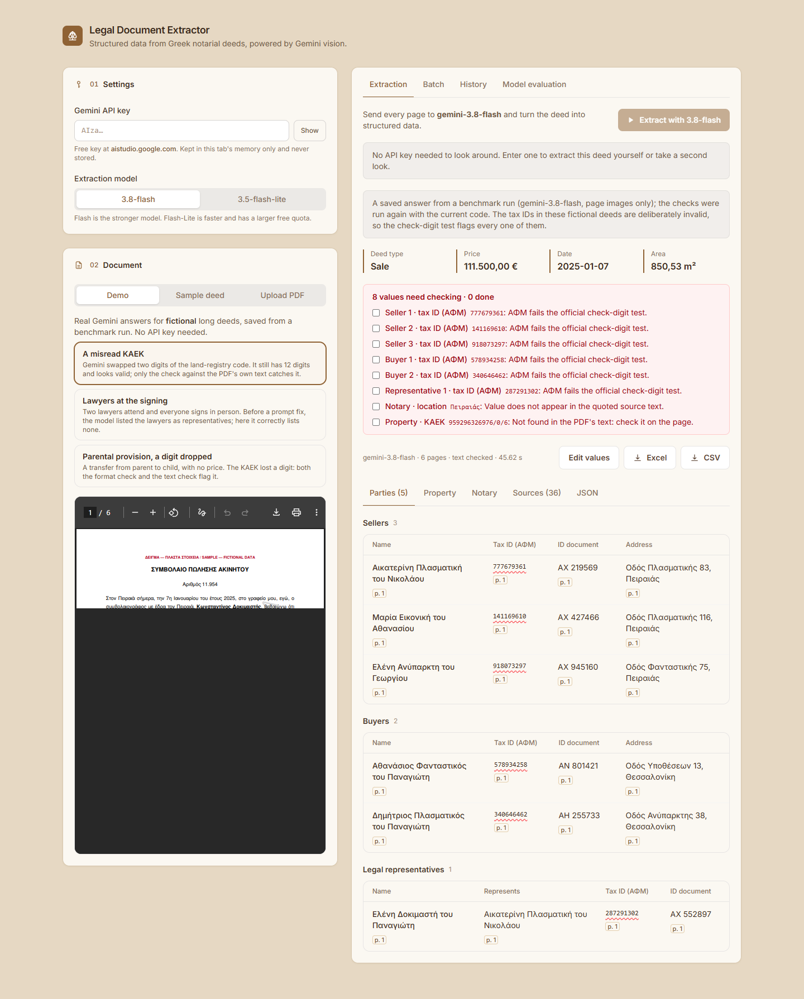
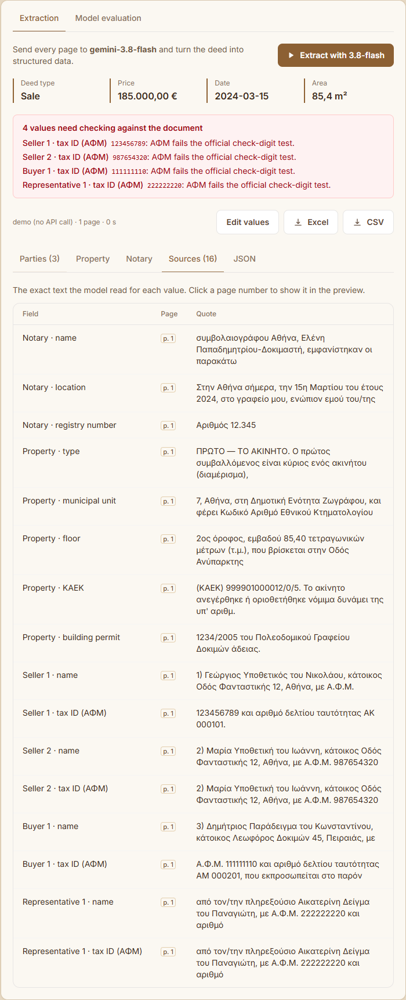
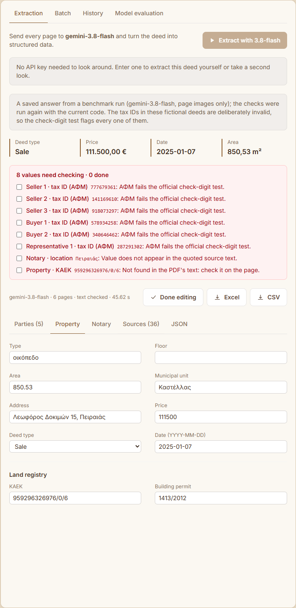
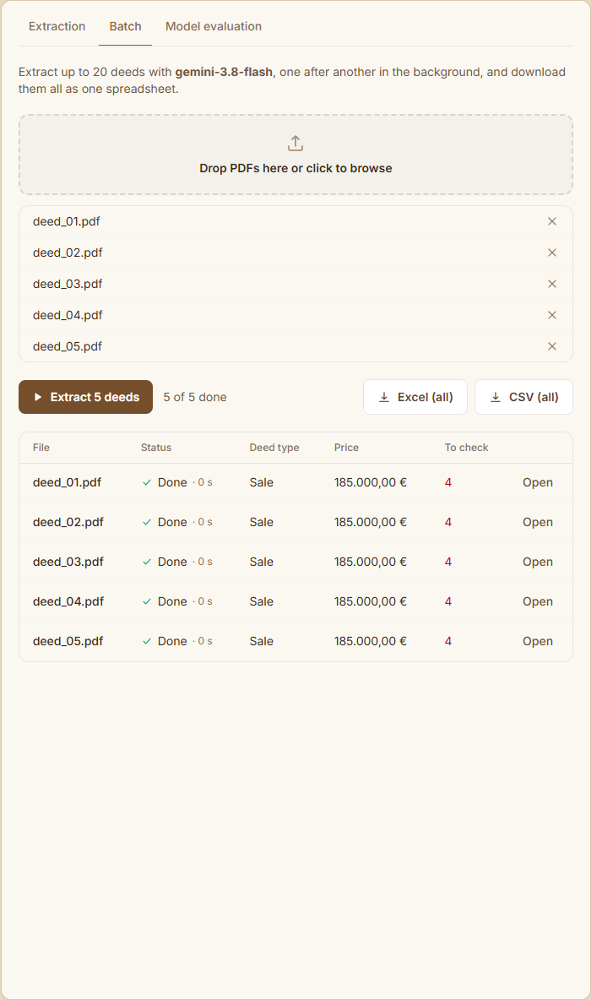

# Legal Document Extractor

[](https://github.com/ManosSanoudakis/legal-document-extractor/actions/workflows/ci.yml)

A full-stack application that extracts structured data from Greek notarial deeds using Google Gemini vision models — a **FastAPI** backend and a **React + TypeScript** frontend, run together with Docker Compose.

---

## Overview

The pipeline converts a PDF into page images (plus the PDF's own text, when it has one), sends them to a Vision Language Model (VLM), and returns a structured JSON object with all key information from the deed — parties, property details, transaction data, and notary information.

- **Schema-enforced output**: Gemini's structured output mode constrains the response to a Pydantic schema, so every response has the same shape.
- **Automatic checks**: every extraction is validated (ΑΦΜ check digits, ΚΑΕΚ format, impossible dates, non-positive amounts) and problems are shown next to the results. For a digital PDF, every copied number and name is also looked up in the PDF's text, which catches a misread digit that still looks valid.
- **Review list and second look**: flagged values form a to-do list with a tick per field. "Second look" reads only those fields again at higher resolution, without showing the model its first answer, and shows whether the two readings agree.
- **Batch and background jobs**: up to 20 deeds at once, processed in the background with a live progress table, and exported together as one spreadsheet.
- **History**: every result is saved with the user's corrections and review ticks — the extracted values only, never the PDF.
- **Demo without a key**: three fictional deeds open on real answers Gemini gave in a benchmark run, so anyone can look around before getting an API key.
- **Measured accuracy**: labelled sets of fictional deeds give field-level accuracy, not just a count of filled-in fields: 100% on long, varied and held-out digital deeds, 99.3% on harsh scans (see [Results](#results)).
- **Model comparison**: Gemini Flash and Flash-Lite run side by side on the same document, scored on accuracy, completeness and latency. Both are on the free tier; Pro can be added on a paid key.
- **Source for every value**: the model cites the page and exact text each value came from; one click shows that page in the preview.
- **Review and export**: correct any value in place (checks re-run automatically), then download Excel or CSV.



<sub>Screenshots show the first demo deed: a real Gemini answer saved from a benchmark run, with the checks re-run (the batch screenshot repeats it for each file unless `GEMINI_API_KEY` is set). Regenerate them with `python scripts/screenshots.py`.</sub>

| Source quotes | Editing | Batch |
|---|---|---|
|  |  |  |

---

## Results

Field-level accuracy of `gemini-3.8-flash` on **synthetic** deeds (fictional, generated with known correct values; see [Evaluation methodology](#evaluation-methodology)). Every field is compared, including those that should be empty, so an invented value counts as wrong. Final prompt, one run per set, 10 deeds each:

| Set | Accuracy | Perfect deeds | Median time |
|---|---|---|---|
| Long deeds full of look-alike values (digital) | **100%** | 10/10 | 29 s |
| Varied wording and layout (digital) | **100%** | 10/10 | 27 s |
| Held-out: new deeds, permit worded and issued differently | **100%** | 10/10 | 29 s |
| Varied, harsh scans (stamps, signatures, no text layer) | **99.3%** | 9/10 | 26 s |

Raw outputs and scores are in [`docs/results/`](docs/results/).

### How it got there

Each step was measured, fixed, and measured again:

| Step | Before | After |
|---|---|---|
| **Lawyers listed as representatives.** In the 4 long deeds with no real representative, Flash listed the lawyers attending the signing. One sentence in the schema and prompt | 92.3%, 5 invented people | 98.6%, none; real representatives still 5/5 |
| **Misread ΚΑΕΚ digits** (one pair swapped, one digit dropped) that still looked valid. The PDF's text now goes with each page image, and every copied value is looked up in it | 98.8% on the same 8 deeds, 2 misreads, ~39 s | 99.6%, 0 misreads, ~27 s |
| **Building permit without its issuing office** («1728/1990»): all 3 errors on the varied deeds, 6 of 7 on their scans. The field now asks for the issuing authority | varied 98.8%, scans 97.5% | varied 100%, scans 99.3% |

The permit fix was found on the varied deeds, so it was also measured on a **held-out set** of ten new deeds whose permit is worded three new ways and issued by three different offices: 100%, every issuing office copied correctly.

### What is left

- **Scans have no text to check against.** The two remaining errors are both on one harsh scan: a ΚΑΕΚ that lost a digit (flagged by the format check) and a representative's ΑΦΜ with one digit misread (0 → 8). On a real deed the ΑΦΜ check digit would usually flag it; the fictional tax IDs fail that test on purpose, so here it cannot be told apart.
- **Flash-Lite**, measured earlier with the first prompt: 95.0% on short deeds, 95.7% on their scans and 79.5% on long ones, with systematic errors (cities dropped from addresses, rare surnames "corrected", representatives invented in every long deed). About 2–3× faster, but not accurate enough to use without review.
- **Limits of these numbers**: the deeds come from one generator, ten per set, one run each. Results vary between runs (the ΚΑΕΚ misreads appeared in one run and not another), so a difference of a point or two is not meaningful. Real deeds vary more, so expect lower accuracy on them.

---

## Architecture

```
PDF                                  (all in deed_extractor/)
 ├── pdf_to_images()        # PyMuPDF → JPEG pages (temporary, deleted after use)
 └── pdf_page_texts()       # the PDF's text layer per page ("" for a scanned page)
      └── BaseExtractor
           └── GeminiExtractor.extract()   # images + text + prompt → JSON constrained by schema.Deed
                ├── validate_deed()        # ΑΦΜ, ΚΑΕΚ, date, amount and text-layer checks
                ├── run_pipeline()         # public entry point → ExtractionResult (deed, meta, validation)
                └── run_recheck()          # second look at flagged fields, 300 dpi, cited pages only
                     ├── evaluate.py       # Flash vs Flash-Lite on one document (+ accuracy if truth known)
                     ├── benchmark.py      # accuracy over a labelled dataset
                     └── api.py            # FastAPI REST endpoints
                          ├── jobs.py      # every long task as a background job, with progress per document
                          ├── history.py   # SQLite: results, corrections, review ticks (never PDFs)
                          ├── demo.py      # saved answers for the demo deeds (no key, no model call)
                          └── frontend/    # React UI (served by nginx, proxies /api)
```

```
Browser ──▶ nginx (web, :8080) ──/api──▶ FastAPI (api, :8000) ──▶ Gemini API
              └── React static build
```

---

## Design Decisions

### Why a VLM instead of a PDF text parser?
Greek notarial deeds are often scanned documents — plain text extraction via `pdfplumber` or `pdfminer` fails on scanned pages. A VLM reads the document visually, the same way a human would.

### Why send the PDF's text as well, when there is one?
An image can be misread; a digital PDF's text cannot. The model gets both: the image for layout and the text for exact characters. In a run on the long deeds, the only two serious mistakes were misread ΚΑΕΚ digits (one pair swapped, one digit dropped). Looking every copied value up in the text catches both, with no false alarms on the true values of any labelled deed. Lines repeated on every page (headers, watermarks) are removed first, or they land in the middle of a value that runs onto the next page.

### Why a "second look" instead of an agent?
An agent loop (think → call a tool → think) costs several model calls per document and is hard to measure. The errors that remain are few and already flagged, so one extra call is enough: only the flagged fields, only the pages they were cited on, at 300 dpi, and without the first answer in the prompt so the second reading cannot simply repeat it.

### Why background jobs?
An extraction takes 20–80 seconds. Holding an HTTP request open that long risks proxy and browser timeouts and shows the user nothing. A job returns at once; the browser polls each document's stage. Every long task goes this way (extraction, model evaluation and second look are all `POST /api/jobs` with a `task`), so there is one way to run slow work, one place for limits, and one place for errors. Documents in a batch run one at a time because free-tier limits are per minute and per day, and a rejected key or exhausted quota stops the rest of the job instead of failing once per document.

Jobs are kept in the API process's memory, on purpose: one server for one office needs no queue or broker. The cost is that a restart loses running jobs, and two API processes would not see each other's jobs. Scaling out would mean a persistent queue (e.g. Redis or the existing SQLite) and separate worker processes; `JobStore` is the only class that would change.

### Why store results but not PDFs?
A deed is full of personal data. History keeps what the user needs to come back to (the extracted values, their corrections and which flags they checked) and nothing more. `HISTORY_RETENTION_DAYS` deletes old entries. The app has no login, so everyone who can reach it sees the same history: run it locally or behind your own access control.

### Why Gemini?
Google AI Studio's free tier covers Gemini Flash and Flash-Lite with vision and structured output, so anyone can run the app and its evaluation without billing. (Pro has no free-tier quota; set `GEMINI_MODELS` to include it on a paid key.) The architecture supports adding other providers (e.g. GPT-4o) by extending `BaseExtractor`.

### Why `BaseExtractor` as an ABC?
Enforces a consistent interface across providers. Any new backend must implement `extract()` — the rest of the pipeline doesn't need to change.

### Why structured output instead of "return only JSON" in the prompt?
Asking for JSON in the prompt works most of the time, but the model can still wrap it in markdown, rename a key or drop a field. With `response_schema`, Gemini is constrained to the Pydantic models in `schema.py`: every key is present, `deed_type` is one of four values, and numbers are numbers. Field descriptions in the schema double as per-field instructions. The old JSON parser stays as a fallback.

### Why validate the output?
A vision model can misread one digit of a tax ID and still sound confident. Some errors can be caught without the source document: the Greek ΑΦΜ has a check digit, a ΚΑΕΚ has 12 digits, a deed cannot be signed in the future, and a price must be positive. Problems are reported, never silently corrected, so a person can verify them against the PDF.

### Why ask for a source quote per value?
A reviewer should not have to search a 20-page deed to verify one tax ID. Each value comes with its page and the text it was read from. The quotes also enable a cheap hallucination check: if a copied value (name, ΑΦΜ, ΚΑΕΚ) does not appear in its own quote, it is flagged.

### Why `area_sqm` and `price` as numbers, not strings?
To support downstream calculations (e.g. price per sqm) without extra parsing. A string would require conversion every time.

### Why a typed result?
Every extraction returns an `ExtractionResult` (in `schema.py`): the `deed`, its `meta` (model, pages, whether the text was checked, seconds, history id) and its `validation` issues. Keeping the deed apart from what was said about it means the deed can be edited, validated and exported as it is, and the API docs show the exact shape. Results saved in history before this change are read in their old shape (deed keys next to `_meta` and `_validation`) and converted on load.

### Why a demo that needs no key?
Most people looking at the app will not make an API key first. The demo deeds open at once on answers Gemini really gave in a benchmark run (`samples/demo/`, built by `scripts/build_demo.py`), with the automatic checks run again by the current code. Nothing is invented, and one of them is the ΚΑΕΚ misread that only the text check catches. With a key, the same deeds can be extracted or evaluated live, and the evaluation scores accuracy because their correct values are known.

### Why DPI 150 for page images?
A trade-off between quality and speed. Lower DPI means smaller files and faster API calls but risks losing fine text. 150 DPI was sufficient for this document type.

### Why FastAPI + React instead of Streamlit?
Separating the API from the UI means the extraction service can be used by any client (scripts, other services) and the frontend has full control over layout and interaction. FastAPI also generates interactive API docs automatically.

### Why does each user bring their own API key?
No key is stored on the server. The browser keeps the key in memory and sends it per request in the `X-Gemini-Key` header, so nobody can spend someone else's quota; the demo covers people without one. For real client deeds, use a paid key: Google's terms allow content sent on the free tier to be used to improve its products, which personal data should not be. A firm would then keep its own key on the server and add logins (see `TODO: SECURITY` in `deed_extractor/api.py`).

### Evaluation methodology
Real deeds cannot be shared, so `samples/make_sample_deed.py` generates fictional deeds together with a JSON file of the correct values. That makes three measurements possible:

- **Accuracy**: every field in the ground truth is compared with the extraction, including fields that should be null, so an invented value counts as wrong. An invented party (for example a lawyer listed as a legal representative) is wrong in every one of its fields, like a missed one. Comparison ignores formatting only (accents, case, spacing, Latin look-alike letters in ID numbers, a name with or without the patronymic (names only: an address without its city is wrong), a municipal unit with or without the "Δημοτική Ενότητα" label). When both models score the same, the faster one is named the winner and the report marks it as a tie.
- **Completeness**: the share of fields that are filled in. Used when no ground truth exists (any uploaded PDF). It rewards invented values, so it is a weak proxy.
- **Disagreement**: fields where the two models return different values, a consistency signal that needs no ground truth.

Latency is measured with `time.perf_counter()`. Both models run in parallel, so an evaluation takes as long as the slower model.

The same ten deeds also exist as **simulated scans** in `samples/dataset_scanned/`: rendered to grayscale images with slight rotation, blur, grain, uneven contrast and heavy JPEG compression, with no text layer. Comparing both sets shows how much scan quality costs.

The short deeds state each value once, so strong and weak models score alike. **Long deeds** in `samples/dataset_long/` (6–8 pages, in larger, widely spaced type like real deeds) keep the same kind of correct answers but surround them with look-alike values: a title history of earlier owners, deed numbers, notaries, dates and prices; other units in the building with their own areas and ΚΑΕΚ; lawyers and an engineer with tax IDs; the assessed value next to the price; tax, mortgage and fee amounts; and a list of attached documents with their own numbers and dates. A model that picks up a look-alike value is marked wrong.

All of these share one template, so a model could do well by learning its wording. **Varied deeds** in `samples/dataset_varied/` are long deeds that also change wording and layout: headings (ΠΡΩΤΟ / Άρθρο 1 / 1.), parties as prose or as «Α.Φ.Μ.: …» fields or with birth year and tax office, dates with the weekday or as 15/3/2024, amounts as «185.000 ευρώ» or «ευρώ 185.000,00», and the sections in another order. Their **harsh scans** in `samples/dataset_varied_scanned/` add what real scans carry: a notary stamp over the text, signatures, a handwritten number in the margin, photocopier streaks, more rotation and lower resolution.

A prompt fix found on one set and measured on the same set can simply be fitted to it. The **held-out set** in `samples/dataset_holdout/` is ten new varied deeds whose building permit is also worded three new ways («άδεια οικοδομής αριθ. …», «οικοδομική άδεια …») and issued by three different offices, so the fix that asks for the permit's issuing office is measured on wording it was not written against.

**Limitation**: the deeds are still generated. Real deeds vary more, and real handwriting is not simulated, so accuracy on real documents will likely be lower.

---

## Project Structure

```
.
├── deed_extractor/                 # The backend package
│   ├── api.py                      # FastAPI REST API
│   ├── extractor.py                # PDF → images (+ text) → VLM → ExtractionResult; second look
│   ├── schema.py                   # Pydantic schema sent to Gemini, and the result types
│   ├── validators.py               # ΑΦΜ, ΚΑΕΚ, date, amount and text-layer checks
│   ├── accuracy.py                 # Field-level scoring against ground truth
│   ├── evaluate.py                 # Flash vs Flash-Lite on one document
│   ├── benchmark.py                # Accuracy over a labelled dataset
│   ├── export.py                   # Excel / CSV export, one deed or many
│   ├── jobs.py                     # Background jobs with progress
│   ├── history.py                  # Saved results (SQLite), never PDFs
│   └── demo.py                     # Saved answers for the demo deeds
├── samples/
│   ├── sample_deed.pdf / .json     # Fictional sample deed + its correct values
│   ├── demo/                       # 3 long deeds with a saved Gemini answer and their correct values
│   ├── dataset/                    # 10 more fictional deeds, each with a .json
│   ├── dataset_scanned/            # The same 10 as simulated scans
│   ├── dataset_long/               # 10 long deeds full of look-alike values
│   ├── dataset_varied/             # 10 long deeds in varied wording and layout
│   ├── dataset_varied_scanned/     # The same 10 as harsh scans (stamps, signatures, notes)
│   ├── dataset_holdout/            # 10 new varied deeds for checking prompt fixes (see below)
│   └── make_sample_deed.py         # Script that generates them
├── tests/                          # pytest suite (no API key needed)
├── scripts/
│   ├── build_demo.py               # Builds samples/demo/ from a saved benchmark run
│   └── screenshots.py              # Regenerates docs/screenshots/
├── .github/workflows/ci.yml        # Lint, tests, frontend build, Docker build
├── frontend/                       # React + TypeScript + Tailwind (Vite)
│   ├── src/
│   │   ├── App.tsx                 # Layout, state, run logic
│   │   ├── api.ts                  # Typed API client
│   │   └── components/             # Settings, document picker, results, evaluation
│   ├── Dockerfile                  # Build with Node, serve with nginx
│   └── nginx.conf                  # Serves the app, proxies /api to the backend
├── Dockerfile                      # Backend image
├── docker-compose.yml              # api + web services
├── pyproject.toml                  # ruff and pytest settings
├── requirements.txt
└── requirements-dev.txt            # + pytest, ruff
```

> **Note:** The app was developed and tested against a real Greek notarial deed, which cannot be shared publicly due to GDPR — it contains personal data (names, ID numbers, addresses). Instead, `samples/sample_deed.pdf` is a **fictional** sale deed in the same format: every name, number and address is invented, and the tax IDs deliberately fail the official check-digit test so they cannot belong to a real person (which is also why the app's checks flag them). Regenerate the sample and all datasets with `python samples/make_sample_deed.py --dataset 10 --scanned --long 10 --varied 10 --harsh --holdout 10`, and the demo with `python scripts/build_demo.py`.

---

## Setup & Run

### Option 1 — Docker (recommended)

```bash
docker compose up --build
```

Open [http://localhost:8080](http://localhost:8080) in your browser.

### Option 2 — Local development (hot reload)

Requires Python 3.11+ and Node.js 20+.

```bash
# Terminal 1 — backend on :8000
python -m venv venv
venv\Scripts\activate          # macOS/Linux: source venv/bin/activate
pip install -r requirements.txt
uvicorn deed_extractor.api:app --reload

# Terminal 2 — frontend on :5173 (proxies /api to :8000)
cd frontend
npm install
npm run dev
```

Open [http://localhost:5173](http://localhost:5173). Interactive API docs are at [http://localhost:8000/docs](http://localhost:8000/docs).

### Option 3 — Command line

```bash
set GEMINI_API_KEY=your-key       # macOS/Linux: export GEMINI_API_KEY=your-key
python -m deed_extractor.extractor --pdf samples/sample_deed.pdf
python -m deed_extractor.evaluate  --pdf samples/sample_deed.pdf --truth samples/sample_deed.json
python -m deed_extractor.benchmark          # accuracy over samples/dataset, saved to benchmark_results.json
python -m deed_extractor.benchmark --dataset samples/dataset_scanned --output benchmark_scanned.json
python -m deed_extractor.benchmark --dataset samples/dataset_long --output benchmark_long.json
python -m deed_extractor.benchmark --dataset samples/dataset_varied --output benchmark_varied.json
python -m deed_extractor.benchmark --dataset samples/dataset_varied_scanned --output benchmark_varied_scanned.json
```

The benchmark saves each model's raw output, so a change to the scoring can be re-applied later without new API calls. Add `--models gemini-3.8-flash` to spend only one model's quota.

### Tests and linting

```bash
pip install -r requirements-dev.txt
ruff check .
python -m pytest
```

The tests mock Gemini, so they need no API key and make no network calls. GitHub Actions runs the same checks on every push, plus the frontend type-check and build (`npm ci` from the lockfile) and the Docker image builds.

### Models

The defaults are `gemini-3.8-flash` and `gemini-3.5-flash-lite`, both available on a free API key. Free-tier quotas are small (Flash allows only a few dozen requests a day), and an evaluation uses one request per model. Gemini Pro has **no** free-tier quota and fails with `429 RESOURCE_EXHAUSTED … limit: 0` on a free key.

Google retires and renames models regularly. Override the list without code changes, e.g. to compare against Pro on a paid key:

```bash
set GEMINI_MODELS=gemini-3.8-flash,gemini-3.1-pro-preview   # first one is the default
docker compose up --build                                    # docker-compose.yml passes it to the api
```

---

## API

| Method | Path | Description |
|---|---|---|
| `GET` | `/api/config` | Available models, limits, whether the sample exists, the demo deeds |
| `GET` | `/api/sample` | The fictional sample deed (PDF) |
| `GET` | `/api/demo/{id}` | A demo deed's saved result. No key needed. |
| `GET` | `/api/demo/{id}/pdf` | A demo deed (PDF) |
| `POST` | `/api/jobs` | Multipart, header `X-Gemini-Key`. The document: `files`, `use_sample=true` or `demo={id}`. `task`: `extract` (default; up to 20 files, optional `model`, results saved to history), `evaluate` (one document, every model; scored for the sample and demos) or `recheck` (one document, `deed` and `fields` as JSON, optional `model`). Returns a job at once. |
| `GET` | `/api/jobs/{id}` | Progress: each document's stage, time and a short summary. Finished jobs are kept for an hour. |
| `GET` | `/api/jobs/{id}/documents/{doc}` | One document's result: an `ExtractionResult`, an evaluation report or a re-check, by task. |
| `GET` | `/api/history` | Saved results, newest first, with what is left to check. |
| `GET` / `PUT` / `DELETE` | `/api/history/{id}` | One saved result: read it, save corrections and review ticks, or delete it. |
| `POST` | `/api/validate` | JSON deed (e.g. after manual corrections). Returns `{"issues": [...]}`. |
| `POST` | `/api/export?format=xlsx\|csv` | JSON deed. Returns an Excel file (sheets *Deed* and *People*) or a CSV. |
| `POST` | `/api/export/batch?format=xlsx\|csv` | `{"deeds": [{"name": ..., "deed": ...}]}`. One row per deed (sheets *Deeds* and *People*). |

Uploads are limited to 20 MB and 30 pages, and model output is capped at 16k tokens. Busy (429) and server (5xx) errors from Gemini are retried up to 3 times with backoff. Every extraction result has the `deed` (with `sources`: page and quote per value), `validation` (failed checks, empty when all pass), `meta` (model, pages, whether the text was checked, seconds, and the history id) and `error` (set if the model's answer could not be parsed).

---

## Usage

0. Without a key: the app opens on a **Demo** deed with a saved answer. Pick another demo, open the review list and sources, edit and export
1. Get a free Gemini API key at [https://aistudio.google.com/apikey](https://aistudio.google.com/apikey)
2. Paste it into **Settings** and pick a model (Flash: stronger / Flash-Lite: faster, larger free quota)
3. Keep a **Demo** deed, choose the **Sample deed**, or switch to **Upload PDF** and drop in your own deed
4. Click **Extract**
5. Work through the flagged values: hover a page link (**p. 1**) to see the quote, click it to open that page, tick each field once checked. **Second look** reads the flagged fields again (one request)
6. Click **Edit values** to correct anything, then download **Excel** or **CSV**. Corrections and ticks are saved to history as you go

For many deeds, use the **Batch** tab: drop up to 20 PDFs, follow the progress, open any result, and download all of them as one spreadsheet. The **History** tab lists every earlier result. To benchmark both models, open the **Model evaluation** tab and click **Run evaluation**.

---

## Extracted Fields

| Section | Fields |
|---|---|
| Notary | name, location, registry number |
| Sellers | full name, tax ID, ID document, address |
| Buyers | full name, tax ID, ID document, address |
| Legal Representatives | full name, represents, tax ID, ID document |
| Property | type, address, municipal unit, floor, area (sqm), KAEK, building permit |
| Transaction | deed type (`sale`, `parental_provision`, `donation`, `other`), price, date (YYYY-MM-DD) |

---

## Assumptions

- A deed may have multiple sellers, buyers, and legal representatives — all are extracted as lists.
- In parental provision deeds, the parent is treated as the seller and the child as the buyer.
- If a field is not found in the document, it is returned as `null`.
- Uploaded PDFs and page images are written to temporary files and deleted after processing; only the extracted results go to history.

---

## Potential Improvements

- **Real-document evaluation**: the labelled datasets are synthetic; a set of anonymised real deeds would give a more honest accuracy figure
- **Highlight in the preview**: draw a box around the quoted text on the page instead of only jumping to the page
- **Add or remove parties while editing**: editing currently changes existing values only
- **Native PDF input**: Gemini accepts PDFs directly, which would remove the image conversion step
- **Multi-document support**: different schemas and prompts per document type (lease, will, etc.)
- **Authentication & usage limits**: needed before hosting the app publicly (see `TODO: SECURITY` in `deed_extractor/api.py`)
- **Confidence scores**: prompt the model to return a confidence value per field
- **Persistent jobs**: a queue and separate workers, so jobs survive a restart and the API can run as several processes
- **Mixed PDFs**: the text check runs only when every page has text; a deed with some scanned pages could check the pages that do
